# Notebook walkthrough — from measured vibration to shaft angle

[← Project overview](../README.md) · [Open the full notebook](../Portfolyo2_Colab_Final.ipynb)

This is the longer explanation behind the results in the README. I kept the notebook as a sequence of small experiments rather than turning it into a software package. Here I follow that same order, show the code that matters in each cell, and explain what I used each calculation to check. The full code is in the `.ipynb`; the short excerpts below are copied from it, not rewritten into cleaner functions.

**Cell numbers are 1–53 in the supplied `Portfolyo2_Colab_Final.ipynb`.** The plots and printed values come from its **saved outputs**; this documentation was not produced by rerunning the raw PHM files. The dataset files are not included in this repository. Where two sections of the notebook give conflicting results, both are shown and the changed calculation is identified.

## Reading the results

The reference is the tachometer-derived **idler angle** unless I explicitly say *input angle*. Phase errors are measured in degrees after aligning estimates at the first valid time sample. TSA correlation describes similarity of two averaged profiles; it is not a measure of shaft-angle accuracy. `sosfiltfilt` is a zero-phase, **noncausal** offline filter, so the notebook is not a demonstration of real-time tracking.

---


## 01. Starting with the recording

The first ten cells answer ordinary questions that are easy to skip: which column is which, how long is the record, and where should a shaft-related peak appear? Getting those wrong would invalidate more sophisticated processing later. Cell 11 is just the `periodogram` import needed by the next step.

### Mechanical frequencies before looking at any spectrum

PHM's spur gearbox uses a 32-tooth input gear driving a 96-tooth gear on the idler shaft. The same idler carries a 48-tooth gear driving an 80-tooth output gear. Ignoring the sign of rotation,

$$
f_{\mathrm{idler}}=\frac{32}{96}f_{\mathrm{input}}=\frac{f_{\mathrm{input}}}{3}.
$$

The two mesh frequencies are $32f_{\mathrm{input}}$ and $48f_{\mathrm{idler}}=16f_{\mathrm{input}}$. The third harmonic of the second mesh falls at $48f_{\mathrm{input}}$: approximately **1920 Hz** at nominal 40 Hz and **1440 Hz** at nominal 30 Hz. The actual frequencies will move with the shaft's measured speed. Those are **starting frequencies for a search**, not guarantees that the largest nearby peak comes from the intended mesh component.

The data contain input-side accelerometer voltage, output-side accelerometer voltage and tachometer voltage. I leave the acceleration channels in volts; I did not convert them into calibrated acceleration units. The tachometer gives ten pulses per input revolution, or **30 pulse intervals per idler revolution**.


### Cell 01 — Load the first healthy recording

```python
data = np.loadtxt("spur 1_40hz_High_1.txt")
```

I begin with the labeled healthy 40 Hz, high-load file. The printed shape is **266,656 × 3**, so the recording is a time-series matrix—not a table of individual machines. The third channel is the tachometer voltage.


### Cell 02 — Put sample indices on a time axis

```python
fs = 66666.67
t = np.arange(len(data)) / fs
print("N:", len(data))
```

The sampling interval is $1/f_s$. At **66,666.67 Hz**, the file lasts **3.99984 s**. From this point on, the FFT frequencies and tachometer times depend on that sampling rate.


### Cell 03 — Inspect the actual waveforms

```python
n = int(0.1 * fs)
fig, axes = plt.subplots(3, 1, sharex=True, figsize=(9, 6))
names = ["Input (V)", "Output (V)", "Tachometer (V)"]
```

I plot a short 100 ms segment of both accelerometer channels and the pulse train. This confirms their rough scales and lets me identify the pulse signal before thresholding it.


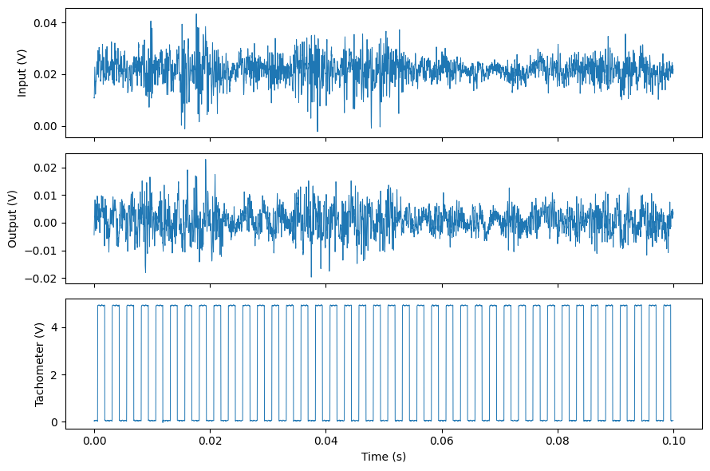


### Cell 04 — Check DC offset before the FFT

```python
mean = np.mean(x)
rms = np.sqrt(np.mean(x**2))
ac_rms = np.sqrt(np.mean((x - mean)**2))
```

The voltage mean is **0.0215733 V**, compared with **0.0047202 V AC RMS**. I do not want the offset to dominate the low-frequency spectrum. RMS includes the offset; AC RMS removes it mathematically.


### Cell 05 — Compute a first one-sided FFT

```python
x = x - np.mean(x)
X = np.fft.rfft(x)
f = np.fft.rfftfreq(len(x), 1/fs)
A = 2*np.abs(X) / len(x)
```

Mean subtraction precedes `rfft`. I use the real FFT because the measured voltage is real-valued. The $2/N$ factor gives the usual one-sided amplitude convention for interior rectangular-window bins; this first plot is for spectral orientation, not precision amplitude metrology.


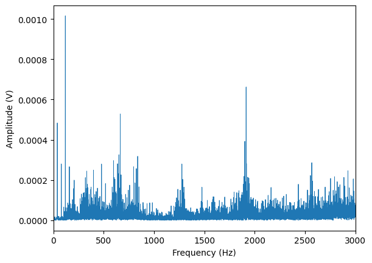


The FFT in Cell 5 is an implementation of the discrete Fourier transform,

$$
X[k]=\sum_{n=0}^{N-1}x[n]e^{-j2\pi kn/N},\qquad f_k=\frac{k f_s}{N}.
$$

For this roughly four-second recording, the bin spacing is $\Delta f=f_s/N\approx0.25$ Hz. A displayed FFT peak is the largest *discrete bin* in a selected interval; its frequency is not a continuously optimized estimate of the underlying line. In a non-integer-cycle window, spectral leakage spreads energy into neighboring bins.

### Cell 06 — Zoom into the expected mesh-harmonic region

```python
plt.xlim(1850, 2000)
plt.xlabel("Frequency (Hz)")
plt.ylabel("Amplitude (V)")
```

The gear geometry points near **1920 Hz** at nominal 40 Hz. I therefore narrow the displayed axis to **1850–2000 Hz** instead of searching the entire spectrum for an arbitrary peak.


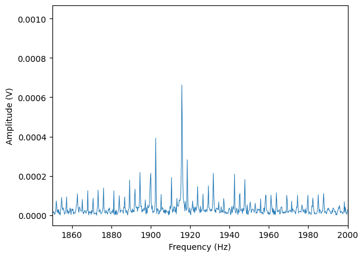


### Cell 07 — Pick an initial carrier candidate

```python
band = (f >= 1910) & (f <= 1920)
fc = f[band][np.argmax(A[band])]
print("Peak frequency:", fc)
```

The largest bin within **1910–1920 Hz** occurs at **1915.8267 Hz**. This is close to the gear-model prediction, but it is not yet proof that the peak follows the intended mechanical order.


### Cell 08 — Draw where the first sidebands should be

```python
fm = 40 / 3

plt.plot(f, A, linewidth=0.7)
```

Using nominal input speed, the idler 1X modulation is $40/3\approx13.33$ Hz. I draw markers at the carrier and plus/minus that value to inspect whether the neighboring peaks fit a modulation pattern.


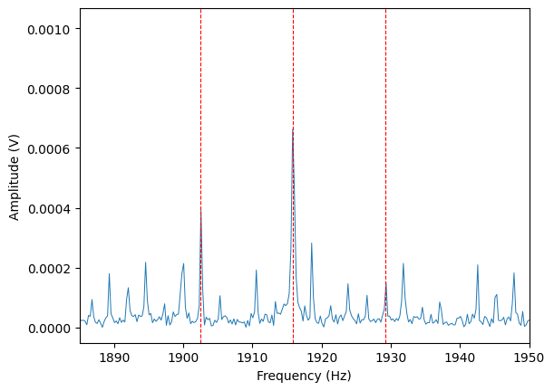


### Cell 09 — Check whether the nearby structure survives Hann windowing

```python
w = np.hanning(len(x))

Xw = np.fft.rfft(x * w)
Aw = 2 * np.abs(Xw) / np.sum(w)
```

A finite observation window spreads sinusoidal energy. Multiplying by the Hann window changes the spectral sidelobes, so I compare it with the rectangular-window FFT. The amplitude normalization uses the Hann coherent gain, `sum(w)`, rather than `N`.


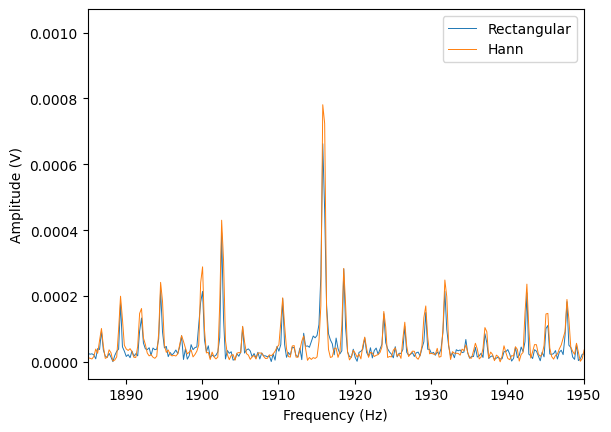


For reference, the Hann window used above is

$$
w[n]=\tfrac12\left(1-\cos\frac{2\pi n}{N-1}\right).
$$

Its taper reduces distant leakage sidelobes but widens the central lobe. That is a trade-off, not a universal reason to prefer Hann over a rectangular window.

### Cell 10 — Turn tachometer pulses into an independent speed estimate

```python
low, high = np.percentile(p, [5, 95])
level = (low + high) / 2

edges = np.where((p[:-1] < level) & (p[1:] >= level))[0] + 1
periods = (edges[10:] - edges[:-10]) / fs
rpm = 60 / np.median(periods)
print("RPM:", rpm)
```

I threshold the voltage halfway between its 5th and 95th percentiles and take rising crossings. There were **1,597 crossings**; the median time across ten pulse intervals gives **2395.21 RPM**. Ten intervals already form one input revolution—no extra division by ten is needed.


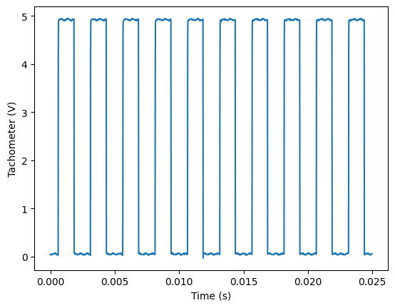


If $e_i$ denotes a detected rising-edge sample index, then **ten intervals** span one input revolution:

$$
T_i=\frac{e_{i+10}-e_i}{f_s},\qquad
\widehat{\mathrm{RPM}}=\frac{60}{\operatorname{median}(T_i)}.
$$

This early RPM estimator uses a median of revolution durations. Later, I compare RPM values calculated by fitting straight lines to complete phase trajectories. Those two estimators need not produce identical numbers, so I use like-for-like phase-slope estimates for the main error comparison.

### Cell 11 — Import the PSD estimator

```python
from scipy.signal import periodogram
```

This import is deliberately before the first use of `periodogram`, so the current notebook no longer has the old clean-kernel import-order problem.


## 02. From the mesh harmonic to modulation and TSA

The initial spectrum suggests energy near the predicted carrier and its neighboring frequencies. Gear eccentricity can change mesh excitation once per idler revolution. A simple amplitude-modulation model makes that visible:

$$
x(t)=A[1+m\cos(2\pi f_dt)]\cos(2\pi f_ct).
$$

Expanding the product creates components at $f_c-f_d$, $f_c$ and $f_c+f_d$. Here $f_d\approx13.3$ Hz at nominal 40 Hz. It would be a mistake to identify a fault simply because a sideband exists; I use the known healthy/eccentric labels to compare the measured modulation.

The phase and envelope of a band-limited real signal come from the analytic signal $z(t)=y(t)+j\mathcal H\{y(t)\}$. Its magnitude $|z(t)|$ tracks amplitude, while $\arg z(t)$ tracks phase. In this section I use **envelope**, not phase, to expose idler-rate modulation.

Time Synchronous Averaging is a change of coordinates: sample the envelope on a shaft-angle grid before averaging revolutions. If $e_r(\theta)$ is the envelope on revolution $r$,

$$
\bar e(\theta)=\frac{1}{M}\sum_{r=1}^M e_r(\theta).
$$

A feature that repeats at the same shaft angle tends to survive this average; unrelated fluctuations can weaken.


### Cell 12 — Compare mesh sidebands between healthy and eccentric recordings

```python
    f, psd = periodogram(x, fs, window="hann", scaling="density")
    df = f[1] - f[0]

    fc = 48 * fin
    fm = fin / 3
    ratio = (powers[0] + powers[2]) / powers[1]
```

I use each recording’s tachometer-derived mean speed to locate the predicted 48X carrier and idler-rate sidebands. The integrated **±2 Hz** band powers give sideband/carrier ratios of **0.3185** (healthy) and **3.1711** (eccentric). Because carrier power also changes, the ratio is not a direct measure of fault severity.


The PSD integral is $P_B\approx\sum_{k\in B}S_{xx}[k]\,\Delta f$ (units $\mathrm{V}^2$ for a voltage signal). The sideband ratio is $(P_L+P_U)/P_C$. It changes if the carrier itself weakens, which is why I keep the individual band powers in the notebook.


### Cell 13 — Demodulate the mesh band with a Hilbert envelope

```python
    sos = butter(4, [fc-45, fc+45], btype="bandpass", fs=fs, output="sos")
    y = sosfiltfilt(sos, x)

    envelope = np.abs(hilbert(y))
    envelope = envelope / np.mean(envelope) - 1
```

Here I retain **±45 Hz** around the 48X carrier, wide enough to include several idler-spaced neighbors. The Hilbert magnitude isolates slower amplitude variation. The normalized envelope 1X band power is **0.014565** (healthy) versus **0.308247** (eccentric), a **21.16×** difference in these two recordings.


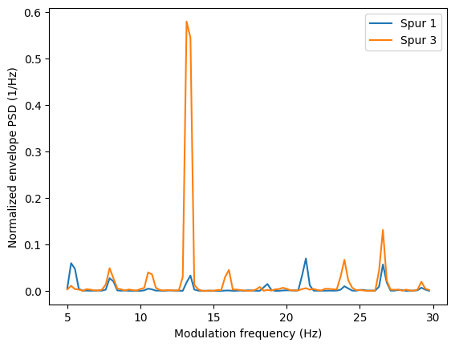


Normalizing the envelope as $e_{\mathrm{norm}}=e/\overline e-1$ makes deviations relative to the mean envelope comparable across the two records. A negative value means “below the mean”, not negative amplitude. The periodogram integrates normalized envelope PSD around idler 1X; those power values are dimensionless mean-square quantities, not watts.

### Cell 14 — Build the tachometer-based TSA and split it in half

```python
        samples = np.interp(angle / 12, np.arange(31), ticks)
        turns.append(np.interp(samples, np.arange(len(x)), envelope))
    first = np.mean(turns[:mid], axis=0)
    second = np.mean(turns[mid:], axis=0)
```

An idler revolution spans **30 input tachometer pulse intervals**; each corresponds to **12 idler degrees** under the rigid gear-ratio assumption. I interpolate a 360-point profile for each complete turn and average them. Splitting the **49** accepted turns gives profile correlations of **0.9448** and **0.9937** for healthy and eccentric.


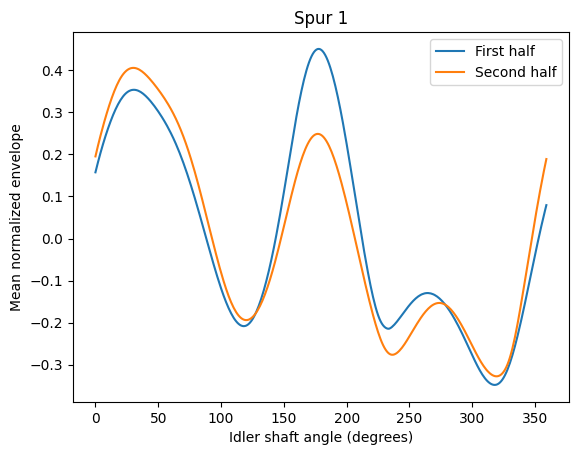


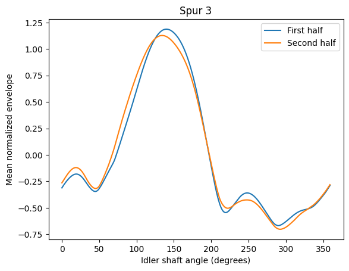


For one idler turn, 30 tachometer intervals represent $360^\circ$, so the `angle / 12` in the interpolation is an index in pulse intervals. A turn's interpolated envelope samples are then evaluated at integer shaft degrees and averaged. This implicitly assumes no missed pulses and approximately uniform pulse-to-angle spacing.


## 03. Getting shaft angle from vibration

This is the central part of the notebook. Instead of using the Hilbert **magnitude** to look for modulation, I now use its **unwrapped phase** to build an angular coordinate.

If the isolated harmonic really tracks the second-mesh third harmonic, its phase is approximately

$$
\phi_c(t)\simeq48\theta_{\mathrm{input}}(t)+\phi_0
           =144\theta_{\mathrm{idler}}(t)+\phi_0.
$$

The corresponding **relative** idler angle is

$$
\widehat\theta_{\mathrm{idler}}(t)=\frac{\phi_c(t)-\phi_c(t_0)}{144}.
$$

The division by 144 comes from the gear ratio and harmonic order; it is not tuned to match the tachometer. `np.angle` only returns phase modulo $2\pi$, so `np.unwrap` is needed before dividing. The reference angle comes separately from the input tachometer pulses: each pulse advances the idler by $2\pi/30$ under the fixed gear-ratio model.

The **±3 Hz** phase filter is intentionally far narrower than the **±45 Hz** envelope filter. Envelope analysis needs sidebands to preserve slow amplitude changes; the initial phase model instead tries to follow a single harmonic without interference from its neighbors. Narrow filtering also smooths real short-term phase variation, which becomes important later.

Mean RPM is estimated by fitting a straight line to phase against time. For carrier-phase slope $a$, $\widehat{\mathrm{RPM}}=60a/(2\pi48)$. The comparison uses a 0.5-second trim at each end to reduce filter edge effects. This is offline signal processing: `sosfiltfilt` looks both forward and backward through the recording.


For two averaged profiles $a[k]$ and $b[k]$, I use Pearson correlation to compare their shape:

$$
\rho=\frac{\sum_k(a_k-\bar a)(b_k-\bar b)}
{\sqrt{\sum_k(a_k-\bar a)^2}\sqrt{\sum_k(b_k-\bar b)^2}}.
$$

Pearson correlation is insensitive to common scaling and offset. That is why I also keep profile peak-to-peak differences and, where computed, profile RMSE. High correlation is not proof of accurate instantaneous shaft angle.

### Cell 15 — Restart the healthy 40 Hz phase experiment

```python
band = (f >= 1900) & (f <= 1930)
fc = f[band][np.argmax(X[band])]
```

I reload the healthy file and look for the carrier in a **1900–1930 Hz** Hann-weighted FFT band. This run again finds **1915.8267 Hz**. Keeping this section self-contained makes it easier to inspect in a notebook.


### Cell 16 — Extract a narrowband analytic phase

```python
sos = butter(4, [fc-3, fc+3], btype="bandpass", fs=fs, output="sos")

y = sosfiltfilt(sos, x)
phase = np.unwrap(np.angle(hilbert(y)))
```

A fourth-order Butterworth bandpass at **$f_c\pm3$ Hz** leaves a relatively isolated carrier. `sosfiltfilt` avoids a one-directional filter delay, and `unwrap(angle(hilbert(...)))` gives a continuous phase trajectory. It is an *offline* estimate.


### Cell 17 — Convert phase slope to RPM

```python
valid = (t > 0.5) & (t < t[-1]-0.5)
slope = np.polyfit(t[valid], phase[valid], 1)[0]
rpm_est = 60 * slope / (2*np.pi*48)
```

I fit a line to the unwrapped phase in the middle three seconds. Dividing by $2\pi\cdot48$ converts carrier cycles per second into input revolutions per second; the result is **2394.9192 RPM**.


The 48X carrier completes 48 cycles per input revolution, so its phase has slope $a\approx2\pi(48f_i)$. Rearranging gives $f_i=a/(2\pi48)$ and multiplying by 60 gives input RPM. The validity of this conversion depends on the tracked spectral component remaining the intended 48X order.


### Cell 18 — Interpolate tachometer pulses into continuous input angle

```python
theta_ref = np.interp(
    t, edges/fs, 2*np.pi*np.arange(len(edges))/10
)
```

Each pulse represents $2\pi/10$ of input-shaft rotation. Interpolating between pulse times produces the practical reference for the phase comparison. This estimate still has pulse-timing and interpolation limits.


### Cell 19 — Align phase origins before calculating angular error

```python
theta_est = (phase - phase[i]) / 48
theta_ref = theta_ref - theta_ref[i]
```

The carrier phase contains an arbitrary constant offset. I subtract both phase values at the start of the valid window, so the plot measures **relative progression error**, not an unknown absolute shaft-zero angle. The median absolute input-angle error is **0.4189°**.


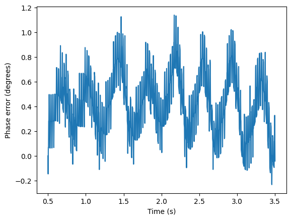


### Cell 20 — Compare average RPM and quantify input-angle error

```python
rpm_ref = 60 * np.polyfit(t[valid], theta_ref[valid], 1)[0] / (2*np.pi)

print("Vibration RPM:", rpm_est)
print("Tachometer RPM:", rpm_ref)
```

Using the same least-squares slope method, tachometer speed is **2394.9219 RPM** versus **2394.9192 RPM** from vibration: a **−0.0026 RPM** difference. Input-shaft angle RMS is **0.4911°**, and the reported linear error drift is **−0.0158 deg/s**.


The RMS angular error over $N$ valid time samples is

$$
\mathrm{RMS}_{\theta}=\sqrt{\frac1N\sum_{n=0}^{N-1}\left[\widehat\theta(t_n)-\theta_T(t_n)\right]^2}.
$$

I also use the 95th percentile of absolute error and the slope of the error over time. The slope catches systematic drift that can be hidden by a single RMS number. The **0.4911°** in Cell 20 refers to input angle; dividing by the 3:1 gear ratio gives the **0.1637° idler-angle** RMS used in the later comparison.

### Cell 21 — Create a virtual idler angle and first TSA

```python
theta = (phase[valid] - phase[valid][0]) / 144

print("Non-increasing steps:", np.sum(np.diff(theta) <= 0))
    points = 2*np.pi * (k + angle/360)
    turns.append(np.interp(points, theta, envelope))
```

Dividing continuous carrier phase by **144** moves into idler revolutions. I check monotonicity before using it as an interpolation axis, then resample the **±45 Hz envelope** at integer idler degrees. The trimmed signal contains **39 complete turns**.


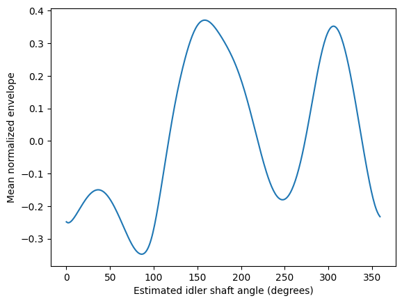


### Cell 22 — Build the comparable tachometer-based idler angle

```python
theta_tach = np.interp(
    t[valid],
    edges / fs,
    2*np.pi*np.arange(len(edges)) / 30
)
```

For idler angle, the input tachometer pulses advance $2\pi/30$ each. This is the reference on the same shaft coordinate as the Hilbert estimate.


### Cell 23 — Use the same complete turns

```python
n_turns = int(min(theta[-1], theta_tach[-1]) / (2*np.pi))
print("Common turns:", n_turns)
```

I restrict both profiles to **39 common turns**. Otherwise a difference in average profiles could be caused simply by averaging a different number of revolutions.


### Cell 24 — Sample one envelope against two angular references

```python
for shaft_angle in [theta_tach, theta]:
    turns = []

    for k in range(n_turns):
        positions = 2*np.pi * (k + angle/360)
```

The envelope does **not** change between comparisons. Only the interpolation axis changes—first measured tachometer angle, then vibration-derived angle. Keeping the signal fixed helps isolate the reference method.


### Cell 25 — Compare the two healthy TSA profiles

```python
print("Profile correlation:", np.corrcoef(reference, virtual)[0, 1])
print("Tachometer peak-to-peak:", np.ptp(reference))
print("Vibration peak-to-peak:", np.ptp(virtual))
```

The healthy 40 Hz profile correlation is **0.9999839**. Peak-to-peak values are **0.718781** for the tachometer and **0.718307** for vibration, in normalized-envelope units. Profile similarity is the practical target here.


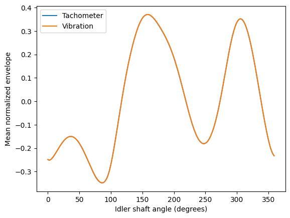


### Cell 26 — Add a constant-speed control

```python
theta_const = 2*np.pi * (rpm_est/60) * time / 3

for name, shaft_angle in [("Hilbert", theta), ("Constant RPM", theta_const)]:
    error = np.rad2deg(shaft_angle - theta_tach)
```

An estimate with just the **average RPM from vibration** has angle $2\pi(\mathrm{RPM}/60)t/3$. It does not use the tachometer. Healthy 40 Hz idler-angle RMS becomes **0.1637° (Hilbert)** versus **0.2422° (constant RPM)**.


The constant-speed idler model used by the code is

$$
\theta_C(t)=\frac{2\pi}{3}\frac{\widehat{\mathrm{RPM}}_{\mathrm{input}}}{60}(t-t_0).
$$

Both competing angle models use vibration to estimate the average speed. The tachometer is not quietly supplying the baseline RPM.


### Cell 27 — Compare all three TSA curves on identical data

```python
for shaft_angle in [theta_tach, theta, theta_const]:
    turns = []

    for k in range(n_turns):
        positions = 2*np.pi * (k + angle/360)
```

Both vibration-derived models produce high profile correlations with the tachometer: **0.9999839** (Hilbert) and **0.9999647** (constant RPM). This warns against confusing very high TSA correlation with uniquely precise instantaneous phase.


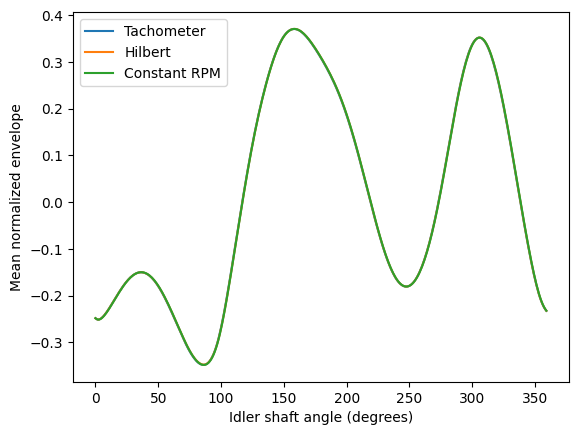


## 04. Repeating the test with an eccentric gear at 40 Hz

The first case was the healthy gearbox. I then repeated the angle estimation with Spur 3, where the 48-tooth idler gear is labeled eccentric. This is not merely a copy of the healthy result: stronger modulation can change the local spectrum, and the selection of a single carrier becomes less straightforward.

The targeted search in Cell 28 looks around the previously observed 40 Hz healthy carrier, within **±7 Hz**, and selects **1912.5766 Hz**. Its reference speed is around **2390.56 RPM**, so the intended order is close to 48X. Using that component gives small idler-angle errors and a close TSA profile match. Later, the more automatic sweep uses a *different search window* and gets a very different answer.


### Cell 28 — Find a carrier in the eccentric 40 Hz recording

```python
band = np.abs(f - 1915.83) <= 7
fc = f[band][np.argmax(A[band])]

sos = butter(4, [fc-3, fc+3], btype="bandpass", fs=fs, output="sos")
phase = np.unwrap(np.angle(hilbert(sosfiltfilt(sos, x))))
```

I search around the healthy measured carrier, **1915.83 ± 7 Hz**, not nominal 1920 ± 8. The maximum in that band is **1912.5766 Hz**, and the phase slope gives **2390.5559 RPM**. This carrier choice becomes important in the final sweep.


### Cell 29 — Reference the eccentric case to its tachometer

```python
theta_t = np.interp(
    t[valid], edges/fs, 2*np.pi*np.arange(len(edges))/30
)
```

As before, I detect rising pulse edges and convert their timing into idler angle. I do not transfer a tachometer-derived phase correction into the Hilbert estimate.


### Cell 30 — Compare eccentric 40 Hz angle errors

```python
rpm_t = 60 * 3 * np.polyfit(time, theta_t, 1)[0] / (2*np.pi)

print("Reference RPM:", rpm_t)
```

At the targeted carrier, reference speed is **2390.5561 RPM**. Hilbert angle RMS is **0.1308°**, and constant-speed RMS is **0.1343°**. The curves are close; neither approach has a decisive advantage here.


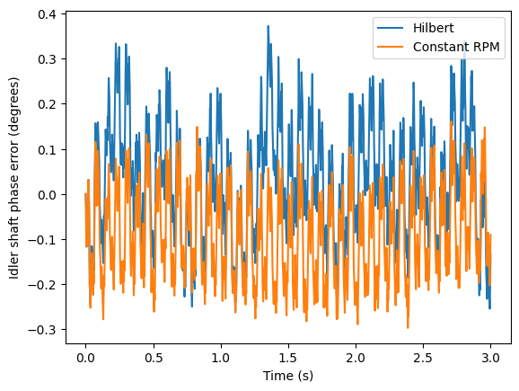


### Cell 31 — Form the diagnostic envelope separately from phase

```python
sos = butter(4, [fc-45, fc+45], btype="bandpass", fs=fs, output="sos")

e = np.abs(hilbert(sosfiltfilt(sos, x)))[valid]
```

I return to the wider **±45 Hz** band for envelope amplitude, normalize it on the trimmed comparison interval, and then keep that identical envelope for all three angular models.


### Cell 32 — Average matched eccentric turns

```python
n_turns = int(min(a[-1] for a in shaft_angles) / (2*np.pi))

profiles = []

for shaft_angle in shaft_angles:
```

Again, one set of 360 angular sample positions is used for each reference, with a common number of complete turns (**39**). This keeps TSA profile differences attributable to the angle axis.


### Cell 33 — Look at the three eccentric profiles together

```python
names = ["Tachometer", "Hilbert", "Constant RPM"]

for name, profile in zip(names, profiles):
    plt.plot(angle, profile, label=name)
```

The measured tachometer, Hilbert-derived angle and constant-speed profile almost coincide in the targeted eccentric 40 Hz case. This is the plot used at the top of the README.


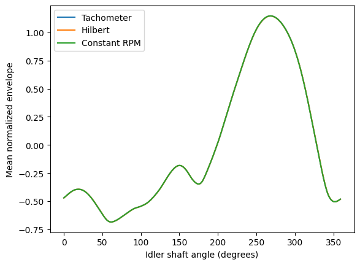


### Cell 34 — Measure eccentric 40 Hz profile agreement

```python
    correlation = np.corrcoef(reference, profile)[0, 1]
    rmse = np.sqrt(np.mean((profile - reference)**2))
```

The targeted run gives **0.9999971 correlation** and **0.001484 normalized-envelope profile RMSE** for Hilbert; constant RPM gives **0.9999954** and **0.001849**. These are comparisons of one recorded envelope under different angular references, not independent detection trials.


For TSA comparison I treat the same normalized envelope as a function of different estimated shaft angles. At each of 360 angular positions, the difference from the tachometer profile contributes to $\mathrm{RMSE}_{\mathrm{profile}}=\sqrt{\frac1{360}\sum_{k=0}^{359}(e_H[k]-e_T[k])^2}$. This is a *profile error*, not an instantaneous angle error.


## 05. Testing the same idea at 30 Hz

Reducing nominal input frequency to 30 Hz moves the 48X candidate to approximately 1440 Hz and the idler rate to roughly 10 Hz. The method is the same: search near the expected component, isolate it, derive Hilbert and constant-RPM angles, and compare both with the tachometer-derived idler angle.

I use the same error definitions for each case. With $\epsilon(t)=\widehat\theta(t)-\theta_{\mathrm{tach}}(t)$ after starting-point alignment,

$$
\mathrm{RMS}_{\theta}=\sqrt{\frac{1}{N}\sum_{n=1}^N\epsilon_n^2},\qquad
P_{95}=\mathrm{percentile}_{95}(|\epsilon|).
$$

The angle units reported here are **idler degrees**. The healthy 30 Hz result is close for both models; on eccentric 30 Hz, the straight-line constant-speed model is notably better than Hilbert's instantaneous correction. That's a useful reason to look at *what the correction is doing*, rather than trying more filters without a diagnosis.


### Cell 35 — Locate the candidate at healthy 30 Hz

```python
expected = 48 * speed
band = np.abs(f - expected) <= 8
fc = f[band][np.argmax(spectrum[band])]
```

The nominal prediction is **1440 Hz**. Searching **±8 Hz** around it returns **1435.5629 Hz**. From here on, I repeat the same angle calculations at the lower operating speed.


### Cell 36 — Make Hilbert and constant-speed angles for healthy 30 Hz

```python
theta_h = (phase[valid] - phase[valid][0]) / 144

rpm_h = 60 * 3 * np.polyfit(time, theta_h, 1)[0] / (2*np.pi)
```

The narrowband phase is divided by 144, anchored to its first valid sample, and fitted for average RPM. The constant-RPM model uses that same speed to keep the baseline independent of the tachometer.


### Cell 37 — Check healthy 30 Hz against measured speed

```python
print("Vibration RPM:", rpm_h)
print("Tachometer RPM:", rpm_t)
print("Observed order:", fc / (rpm_t/60))
```

The vibration estimate is **1794.3326 RPM**, the tachometer reference **1794.3274 RPM**. The selected FFT peak has measured order **48.0034X**, consistent with tracking the intended harmonic.


### Cell 38 — Compare the two healthy 30 Hz errors

```python
for name, theta in [("Hilbert", theta_h), ("Constant RPM", theta_c)]:
    error = np.rad2deg(theta - theta_t)

    rms = np.sqrt(np.mean(error**2))
    p95 = np.percentile(np.abs(error), 95)
```

The constant-speed model has slightly lower idler-angle error: **0.0828° RMS** versus **0.0900°** for Hilbert. The difference is small but argues against claiming that instantaneous correction always improves accuracy.


### Cell 39 — Inspect how the healthy 30 Hz errors evolve

```python
plt.plot(time, np.rad2deg(theta_h-theta_t), label="Hilbert")
plt.plot(time, np.rad2deg(theta_c-theta_t), label="Constant RPM")
```

The RMS values alone hide whether the error is a drift, slow oscillation, or transient excursion. This plot keeps both error trajectories on the same time axis.


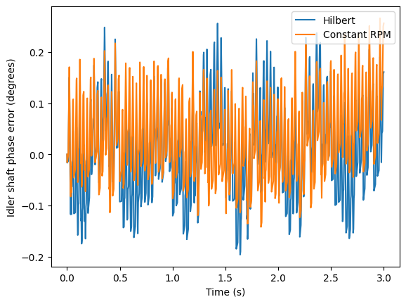


### Cell 40 — Locate the candidate at eccentric 30 Hz

```python
expected = 48 * speed
band = np.abs(f - expected) <= 8
fc = f[band][np.argmax(spectrum[band])]
```

Applying the same nominal **1440 ± 8 Hz** search to eccentric Spur 3 selects **1436.0575 Hz**. Carrier selection is checked again after building the tachometer reference.


### Cell 41 — Create the two eccentric 30 Hz angle estimates

```python
sos = butter(4, [fc-3, fc+3], btype="bandpass", fs=fs, output="sos")

phase = np.unwrap(np.angle(hilbert(sosfiltfilt(sos, x))))
```

There is no algorithm switch between healthy and eccentric 30 Hz: the same **±3 Hz** phase band, `/144` conversion and constant-RPM baseline are used. That makes the condition comparison easier to interpret.


### Cell 42 — Verify the eccentric 30 Hz selected order

```python
print("Vibration RPM:", rpm_h)
print("Tachometer RPM:", rpm_t)
print("Observed order:", fc / (rpm_t/60))
```

The tachometer-derived mean speed is **1795.1820 RPM** against **1795.1523 RPM** from vibration. The selected peak gives **47.9971X**. Its order is not the obvious reason the short-term angle error is larger.


### Cell 43 — Report the eccentric 30 Hz short-term errors

```python
for name, theta in [("Hilbert", theta_h), ("Constant RPM", theta_c)]:
    error = np.rad2deg(theta - theta_t)

    rms = np.sqrt(np.mean(error**2))
    p95 = np.percentile(np.abs(error), 95)
```

This is the clearest example where instantaneous Hilbert tracking does worse: **0.3566° RMS** versus **0.2665°** for constant RPM. Their 95th-absolute-error values are **0.6552°** and **0.4728°**, respectively.


### Cell 44 — See both eccentric error traces

```python
plt.plot(time, np.rad2deg(theta_h-theta_t), label="Hilbert")
plt.plot(time, np.rad2deg(theta_c-theta_t), label="Constant RPM")
```

Plotting both time trajectories makes it easier to see the extra structure introduced by Hilbert phase. This is why I did not stop at a table of average RPM values.


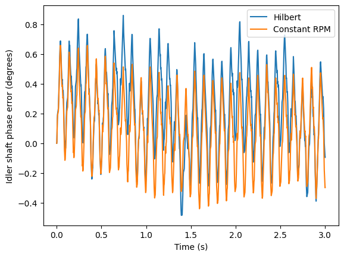


### Cell 45 — Double-check carrier order instead of blaming the filter

```python
order = fc / (rpm_t / 60)

print("Selected frequency:", fc)
print("Observed order:", order)
```

The measured order is **47.9971X** and the frequency expected from tachometer-derived average speed is **1436.1456 Hz**, close to the chosen **1436.0575 Hz**. This order check does not prove phase fidelity, but it makes a simple wrong-harmonic explanation less likely here.


### Cell 46 — Repeat the error comparison with a shared plot

```python
for name, theta in [("Hilbert", theta_h), ("Constant RPM", theta_c)]:
    error = np.rad2deg(theta - theta_t)

    rms = np.sqrt(np.mean(error**2))
    p95 = np.percentile(np.abs(error), 95)
```

This cell repeats the eccentric 30 Hz error metrics while adding an overlaid error plot. It is redundant mathematically, but it preserves the notebook’s exploratory sequence without rewriting the original code.


## 06. Why the instantaneous correction can make things worse

For eccentric 30 Hz, I separated the deviations from the constant-speed model:

$$
r(t)=\theta_{\mathrm{tach}}(t)-\theta_{C}(t),\qquad
 d(t)=\theta_H(t)-\theta_C(t).
$$

The constant-speed error is $-r$ and the Hilbert error is $d-r$. That gives the exact mean-squared-error relation

$$
\mathrm{MSE}_{H}-\mathrm{MSE}_{C}=E[d^2]-2E[dr].
$$

The first term penalizes adding a correction at all; the second rewards a correction that lines up with the reference deviation. This is the simplest way to see why a phase estimate can look sophisticated but still be worse than a straight line. I then compared the frequencies in $r$ and $d$, and tried phase filters wide enough to pass the roughly 10 Hz idler-rate modulation.


### Cell 47 — Separate reference motion from the Hilbert correction

```python
r = np.rad2deg(theta_t - theta_c)
d = np.rad2deg(theta_h - theta_c)

plt.plot(time, r, label="Tachometer deviation", linewidth=0.8)
```

The two deviations $r=\theta_T-\theta_C$ and $d=\theta_H-\theta_C$ are computed in degrees. Their Pearson correlation is only **0.047755**. The correction is not following the measured reference deviation closely in this recording.


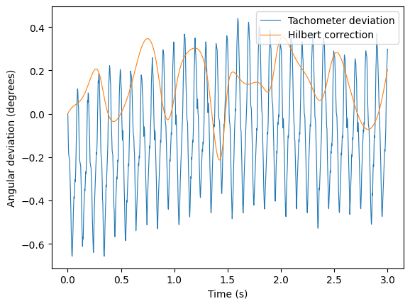


### Cell 48 — Calculate whether the extra correction helps

```python
penalty = np.mean(d**2)
gain = 2 * np.mean(d*r)

print("Correction energy:", penalty)
```

For this run $E[d^2]=0.0332296\ \mathrm{deg}^2$ and $2E[dr]=-0.0229000\ \mathrm{deg}^2$, yielding **MSE(Hilbert) − MSE(constant) = +0.0561296 deg²**. The correction adds error rather than removing it.


### Cell 49 — Look for the frequencies behind the disagreement

```python
for name, signal in [("Tachometer", r), ("Hilbert", d)]:
    freq, psd = periodogram(signal - np.mean(signal), fs, window="hann")

    plt.plot(freq, psd, label=name)
```

The tachometer deviation has its strongest reported peak near **10.0006 Hz** in the examined 5–20 Hz range; the Hilbert correction peaks near **6.0004 Hz**. This mismatch motivates a filter-bandwidth check, although tachometer pulse geometry and interpolation may also contribute to the reference deviation.


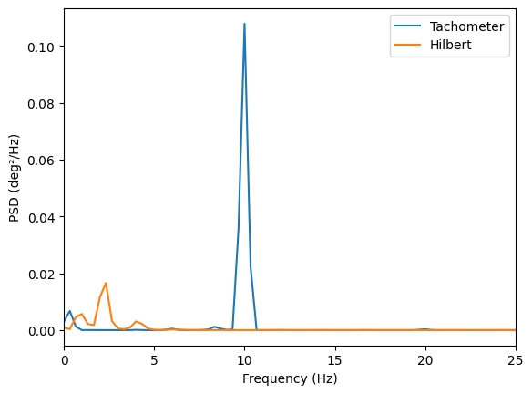


### Cell 50 — Widen the phase filter as a direct test

```python
widths = [3,12,20]
```

The loop applies each half-width to the same fourth-order Butterworth filter and recalculates phase-error RMS and P95 against the same tachometer reference.

If the narrow phase filter had removed useful modulation around 10 Hz, a wider band might help. It does the opposite: **0.3566° RMS** at ±3 Hz becomes **6.2538°** at ±12 Hz and **9.3981°** at ±20 Hz. Wider is not automatically more faithful.


## 07. The final cross-case sweep, including the failure

The last three cells bring the tests together. They are present **with saved outputs** in the supplied notebook. The loop requests healthy and eccentric cases at nominal **30, 40 and 50 Hz**, but the two 50 Hz recordings were absent when it ran. Only four conditions produced rows.

An important issue appeared in the 40 Hz eccentric run. The earlier targeted search selected **1912.5766 Hz** and worked well. The last loop instead selects the biggest FFT peak within **±8 Hz around 1920 Hz**, returning a frequency with measured order **48.3359X** and a very poor reconstruction. The intended 48X component was not recovered by that rule. The frequency separation is about one idler 1X (roughly 13.3 Hz), so the alternative peak is *consistent with* a sideband; the stored outputs do not by themselves prove the source.

The lesson here is specific, not a universal claim about Hilbert phase: **carrier selection and phase tracking are different problems**. A reliable order-tracking workflow needs to guard against locking onto a nearby modulated component.


### Cell 51 — Run a common workflow across requested speeds and conditions

The sweep attempts these files:

```python
for speed in [30, 40, 50]:
    for case in [1, 3]:
        filename = Path(f"spur {case}_{speed}hz_High_1.txt")
```

Its local peak-selection rule is:

```python
        band = np.abs(f - 48*speed) <= 8
        fc = f[band][np.argmax(spectrum[band])]
```

The loop requests **30/40/50 Hz**, Spur 1/3, high load, first repeat, and stores angle and TSA metrics. It reports **50 Hz files missing**, so its result list contains four rows. Crucially, its automated `48*speed ± 8 Hz` peak rule is **not the same** as the targeted eccentric 40 Hz rule from Cell 28.


**Why the last 40 Hz eccentric result is so different.** Cell 28 uses `abs(f - 1915.83) <= 7` and finds 1912.5766 Hz. Cell 51 uses `abs(f - 48*speed) <= 8`, i.e. 1912–1928 Hz at nominal 40 Hz. In the eccentric recording the stronger peak in this new band has observed order 48.3359X, not approximately 48X. Dividing its phase by 144 then forces the wrong oscillation to stand in for shaft angle. The discrepancy is a **carrier-selection failure in this sweep**, not evidence that the earlier numbers were recomputed or that Hilbert tracking works universally.


### Cell 52 — Plot the four saved validation profiles

```python
if results:
    speeds = sorted(set(row["speed"] for row in results))
    fig, axes = plt.subplots(len(speeds), 2, figsize=(11, 3.5*len(speeds)), squeeze=False)
```

This grid makes the automated-selection problem visible: three panels show close overlap, whereas **eccentric 40 Hz** does not. I keep the unsuccessful panel instead of replacing it with the earlier favorable targeted result.


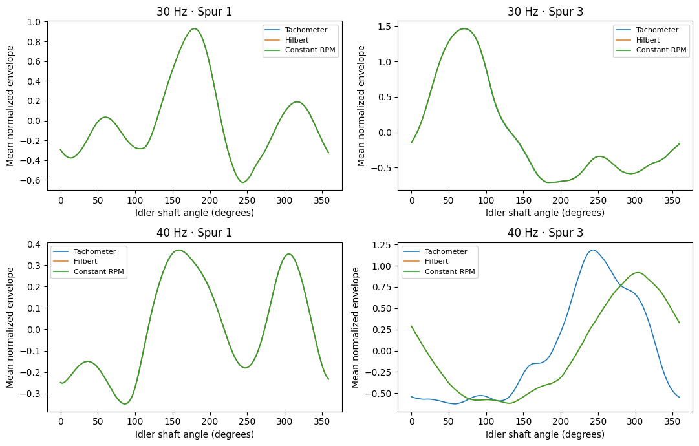


### Cell 53 — Print the final numbers and preserve the contradiction

```python
print("FINAL VALIDATION — High load, first recording")
print("Shaft angle: idler degrees | Reference: measured tachometer")
```

The cell then prints each row's RPM difference, selected order, Hilbert/constant angle RMS, TSA correlation and profile RMSE. These are saved outputs, not numbers inferred from the figure.

Three sweep rows give near-48X orders and high TSA correlation. In the eccentric 40 Hz row the order is **48.3359X**, Hilbert RMS becomes **57.3750°** and its TSA correlation falls to **0.6202607**. The earlier **0.1308° / 0.9999971** result belongs to a different carrier-selection rule. Both outputs are part of the notebook, and they must not be merged as if they describe the same implementation.


---

## Quick comparison of the two 40 Hz eccentric analyses

| How the carrier was selected | Selected order | Hilbert idler angle RMS | Hilbert TSA correlation |
|---|---:|---:|---:|
| Targeted search in Cell 28 | Near 48X (1912.5766 Hz) | **0.1308°** | **0.9999971** |
| Nominal-frequency sweep in Cell 51 | **48.3359X** | **57.3750°** | **0.6202607** |

The notebook does not contain a corrected rerun of the final sweep with a carrier-selection guard. I would not claim a successful automated multi-case tracker from these outputs. It does contain enough evidence to distinguish a working **targeted** phase estimate from a failed **automatic** peak choice.

## What I would check next

1. Validate carrier candidates by **order consistency and neighboring sideband structure**, not maximum peak height alone. Without a tachometer available at inference time, that requires a vibration-based speed estimate plus the known gear ratio, and it needs testing rather than assuming it always works.
2. Repeat both healthy and eccentric tests on independent recordings; the current comparisons mainly use the first high-load repeat.
3. Try known transient-speed recordings only after the steady-speed carrier-selection problem is solved. A filter that works around a stationary 48X line is not guaranteed to follow a moving one.
4. Separate true shaft-speed fluctuation from tachometer pulse spacing, torsional dynamics and other sources of apparent phase modulation before interpreting the 10 Hz reference deviation as physical shaft motion.

## Reproducing the notebook

Get the labeled **PHM Society 2009 Gearbox Fault Diagnosis** text files from the [dataset owner](https://phmsociety.org/public-data-sets/). Put the selected `.txt` recordings beside [`Portfolyo2_Colab_Final.ipynb`](../Portfolyo2_Colab_Final.ipynb) and install the dependencies in [`requirements.txt`](../requirements.txt). The code uses the input-side accelerometer (column 0) and tachometer (column 2). The output-side accelerometer is visualized at the beginning but not used for angle reconstruction.

The latest notebook has **53 Python code cells**. The final sweep handles absent files by printing `Missing recording`, rather than silently manufacturing a 50 Hz result. The 50 Hz rows in the saved run are absent because the relevant raw recordings were missing.

## Sources for data and signal-processing definitions

- [PHM Society 2009 Gearbox Fault Diagnosis dataset](https://phmsociety.org/public-data-sets/)
- [PHM Society gearbox apparatus](https://phmsociety.org/data-analysis-competition/apparatus/)
- [SciPy signal-processing functions](https://docs.scipy.org/doc/scipy/reference/signal.html) (`butter`, `sosfiltfilt`, `hilbert`, `periodogram`)

